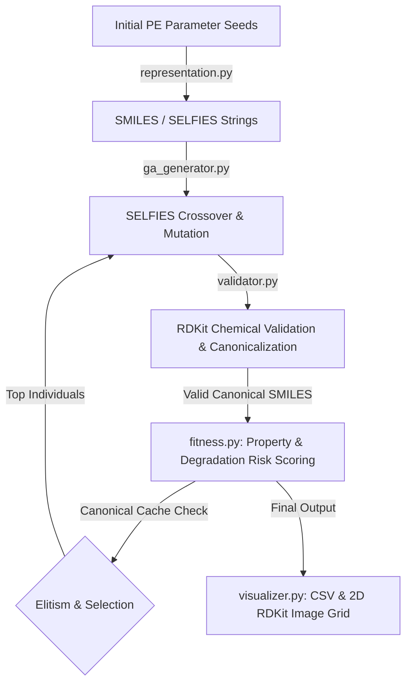

# Polyethylene (PE) GA Optimization Package Documentation (`codebase/PE`)

This directory contains the Python implementation of the **Polyethylene (PE) Genetic Algorithm (GA) Optimization System**. The system is designed to optimize PE polymer monomer structures (HDPE, LDPE, LLDPE) to minimize thermal degradation during plastic melting while optimizing the Number Average Molecular Weight ($M_n$).

The theoretical foundation and experimental variables are based on the project specification in `11054 이강준 증빙자료 유전.pdf`.

---

## 1. Core Experimental Variables & Scientific Rationale

### Research Question & Hypothesis
* **Core Question**: Can adjusting the Number Average Molecular Weight ($M_n$) and branching architecture at the plastic melting point resolve thermal degradation issues in thermoplastic resins?
* **Hypothesis**: Increasing $M_n$ while controlling weak tertiary carbon branch points reduces thermal degradation damage during melting cycles.

### Variable Mapping

| Variable Type | Variable Name | Implementation Parameter | Scientific Significance |
| :--- | :--- | :--- | :--- |
| **Independent** | Backbone Length | Degree of Polymerization ($DP$) | Determines chain entanglement and base mass |
| **Independent** | Branch Density | Number of branches ($N_{branch}$) | Controls crystallinity, flexibility, and $T_m$ |
| **Independent** | Branch Length | $L_{branch}$ (Methyl, Ethyl, Butyl, etc.) | Distinguishes short-chain vs long-chain branching |
| **Independent** | Branch Directionality | Stereochemistry / Bending angle | Influences spatial packing and density |
| **Dependent** | Molecular Mass | Number Average Molecular Weight ($M_n$) | Target metric for retention |
| **Dependent** | Thermal Stability | Degradation Risk Index | Ratio of tertiary $\text{-CH}(R_1)(R_2)\text{-}$ bonds |
| **Dependent** | Thermal Point | Estimated Melting Temp ($T_m$) | Boundary for plastic melting simulations |

---

## 2. System Architecture & Data Flow

The package follows a **Dual-Representation Hybrid GA Workflow**:



### Why Dual Representation (SELFIES + SMILES)?
* **SELFIES (Self-Referencing Embedded Strings)**: Used for genetic operations (crossover and mutation). Unlike raw SMILES where random character edits break chemical syntax, **100% of SELFIES mutations generate valid molecular graphs**.
* **SMILES (Simplified Molecular Input Line Entry System)**: Used for RDKit molecular descriptor calculations, canonicalization (deduplication via `RDKit.Canonicalize`), and visualization.

---

## 3. Detailed Module Breakdown

### A. `codebase/PE/representation.py`
Provides structural modeling for Polyethylene chains and branches.

* **`PEBranch` Class**:
  * Attributes: `position` (carbon index on backbone), `length` (carbon chain length of branch), `bend_direction` (`left`, `right`, `straight`).
  * `to_smiles_substituent()`: Converts branch specification to SMILES substituent notation e.g., `(C)` for methyl, `(CC)` for ethyl, `([C@H]C)` for stereospecific branches.
* **`PERepresentation` Class**:
  * Represents full PE molecule with backbone $DP$ (total backbone carbons = $DP \times 2$) and sorted `branches`.
  * `to_smiles()`: Assembles backbone carbons and inserts branch substituents at target positions.
  * `to_selfies()`: Converts resulting SMILES to SELFIES (with fallback string handling if library is absent).
  * `from_selfies(selfies_str)` & `from_smiles(smiles_str)`: Reconstructs `PERepresentation` instances from string inputs.

---

### B. `codebase/PE/validator.py`
Handles chemical structure validation and canonicalization.

* **`PEValidator.validate_smiles(smiles)`**:
  * Validates valence rules and sanitizes molecules via `rdkit.Chem.SanitizeMol`.
  * Includes a fallback regex check for hypervalent carbons if RDKit is not installed locally.
* **`PEValidator.canonicalize(smiles)`**:
  * Converts SMILES into unique Canonical SMILES.
  * Ensures that different representations of the same structure (e.g. `CCCC(C)CC` vs `CCC(C)CCC`) map to identical keys for caching.
* **`PEValidator.validate_and_canonicalize(smiles)`**:
  * Returns `(is_valid, canonical_smiles)` tuple in a single call.

---

### C. `codebase/PE/fitness.py`
Calculates chemical properties, thermal degradation risk, and composite fitness scores.

* **Calculated Properties**:
  1. **$M_n$ (Molecular Weight)**: Extracted via `Descriptors.MolWt(mol)` (or formula mass fallback $12.011 \times C + 1.008 \times H$).
  2. **Tertiary Carbon Count & Degradation Risk Index**:
     * Tertiary carbon sites ($\text{-CH}(R_1)(R_2)\text{-}$) have lower C-H bond dissociation energies ($\sim 390\text{ kJ/mol}$) compared to secondary $\text{-CH}_2\text{-}$ carbons ($\sim 410\text{ kJ/mol}$).
     * Under thermal melting conditions, higher tertiary carbon ratio increases thermal chain scission susceptibility.
     * Substructure pattern: `[CH1]([#6])([#6])[#6]`.
     * `degradation_risk_index` = $\min(1.0, 3.0 \times \frac{N_{tertiary}}{N_{total\_carbons}})$.
  3. **Estimated Melting Point ($T_m$)**:
     * $T_m(^\circ\text{C}) = 135.0 - (\text{tertiary\_ratio} \times 60.0) + \min(15.0, \frac{M_n}{100.0})$, clamped to $[80^\circ\text{C}, 145^\circ\text{C}]$.
  4. **Composite Fitness Score**:
     $$\text{Fitness} = w_{mn} \cdot \min\left(1.0, \frac{M_n}{\text{Target } M_n}\right) + w_{stability} \cdot (1.0 - \text{Degradation Risk Index})$$

---

### D. `codebase/PE/ga_generator.py`
Executes the Genetic Algorithm optimization loop.

* **`PEGAGenerator` Class**:
  * `initialize_population()`: Generates initial population of random linear and branched PE chains.
  * `evaluate_population()`: Evaluates fitness while caching canonical SMILES results in `evaluated_cache` to avoid duplicate computation.
  * `crossover_selfies(parent1, parent2)`: Performs single-point crossover on SELFIES token sequences.
  * `mutate_selfies(selfies_str)`: Mutates SELFIES tokens (inserting, deleting, or modifying tokens).
  * `step_generation(population)`:
    * Selects top 20% elites (**Elitism**).
    * Performs **Tournament Selection** to select parents for crossover & mutation.
    * Returns `(next_generation_population, sorted_scored_population)`.

---

### E. `codebase/PE/visualizer.py`
Generates summary reports and 2D molecular drawings.

* **`PEVisualizer.create_dataframe(scored_population)`**: Exports generation metrics into Pandas DataFrame or dictionary list.
* **`PEVisualizer.save_dataframe_csv(df, filepath)`**: Saves results to CSV (`output_pe/pe_optimization_results.csv`).
* **`PEVisualizer.draw_top_molecules(scored_population, output_image_path, top_k=6)`**: Draws 2D molecular structures for the top-$k$ candidates with scores and metrics annotated via `rdkit.Chem.Draw.MolsToGridImage`.

---

### F. `codebase/PE/main.py`
Command-Line Interface (CLI) entry point.

#### Supported Arguments:
* `--generations` (default: 10): Number of GA optimization generations.
* `--pop_size` (default: 15): Number of individuals in population per generation.
* `--target_mn` (default: 1000.0): Target $M_n$ molecular weight in g/mol.
* `--output_dir` (default: `output_pe`): Destination folder for output CSV and PNG images.

---

## 4. How to Run

### Installation Requirements
```bash
pip install -r codebase/PE/requirements.txt
```
*(Dependencies: `rdkit`, `selfies`, `pygad`, `pandas`, `torch`, `mordred`)*

### Local Verification Test Suite
To run the automated unit tests:
```bash
python3 -m unittest discover -s codebase/PE/tests
```

### Running PE Optimization Loop
Basic execution:
```bash
python3 codebase/PE/main.py --generations 10 --pop_size 15 --target_mn 1200.0
```

Execution on Remote Windows Workstation:
```cmd
python codebase\PE\main.py --generations 50 --pop_size 30 --target_mn 2500.0 --output_dir output_pe_run1
```

---

## 5. Output Deliverables
Running the pipeline produces:
1. **Console Logs**: Generation-by-generation progression of best fitness score, $M_n$, degradation risk index, and estimated $T_m$.
2. **`output_pe/pe_optimization_results.csv`**: Full tabular log of all evaluated canonical PE structures.
3. **`output_pe/top_pe_candidates.png`**: 2D molecular grid drawings of top-ranked PE structures.

Points to improve upon: optimizing the genetic algorithm, making sure that all of the formulae are backed up by intense research (this is just a placeholder to avoid getting grilled by my team lol)

Also i bluffed to my team that i would use 3d printing for final product, so need to keep that in mind

Also mind that i may try to actually try to produce these polymers in lab, so also mind that